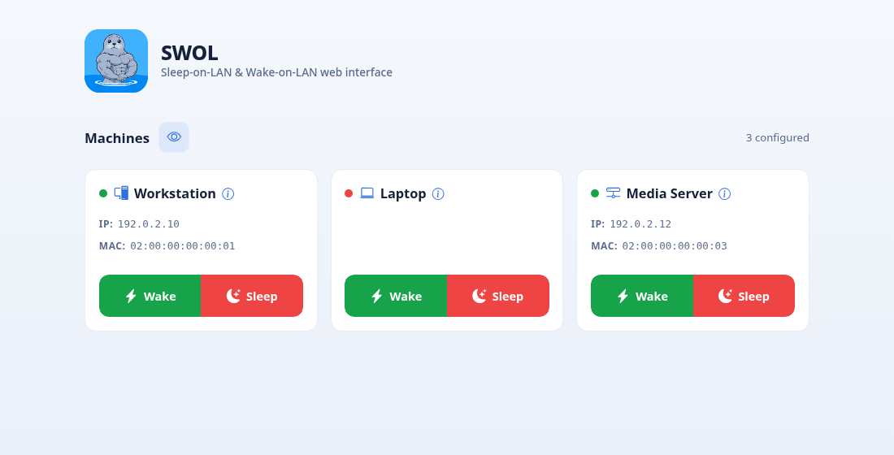
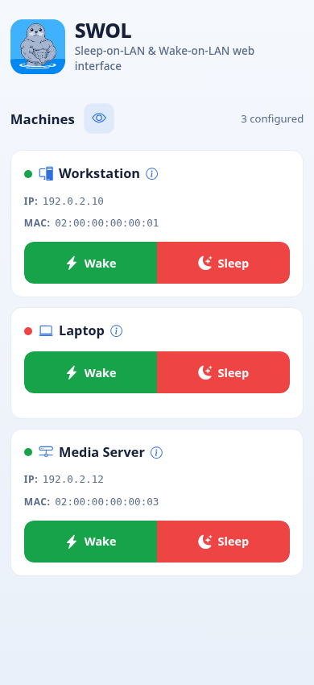

# GitHub repositories are now mirror only

Due to recent changes in GitHub's direction, development has migrated to: https://git.ribas89.co.uk/

Have a issue/question? https://link.ribas89.co.uk/ask


Thank you for your support ❤️!


<p align="center">
  
</p>

<h1 align="center">SWOL</h1>

A CLI tool to send Wake-On-LAN (WOL) magic packets to wake up devices on your
network. Features both CLI commands and a web interface, plus optional Sleep-on-LAN requests.

Designed to work with [sleep-on-lan-macos](https://github.com/ribas89/sleep-on-lan-macos)
for Sleep-on-LAN support on macOS.

<table>
  <tr>
    <th width="68%" align="center">Web interface</th>
    <th width="32%" align="center">Mobile interface</th>
  </tr>
  <tr>
    <td align="center" valign="top">
      
    </td>
    <td align="center" valign="top">
      
    </td>
  </tr>
</table>

## Features

- Send WOL magic packets via CLI or web interface
- Configure multiple machines with names for easy access
- Configurable broadcast address and port, with per-machine overrides
- List configured machines
- Web interface for easy wake-up and optional sleep requests
- Responsive machine cards, customizable icons, and per-machine display options
- IP/MAC masking enabled by default in the web interface
- Scheduled wake-ups on a cron schedule
- Docker support

## Installation

### Using Go

Build SWOL from this source repository using Go 1.26 or newer:

```sh
go build -o swol .
./swol serve
```

### Using Docker

Build the image locally from this repository:

```sh
docker build -t swol:local -f docker/Dockerfile .
docker run --network host -v "$(pwd)/config.yaml:/etc/swol/config.yaml:ro" swol:local serve
```

Or using docker-compose:

```yaml
# Method 1: Using bind mount
services:
  swol:
    image: swol:local
    command: serve # To start the web interface
    network_mode: "host"
    volumes:
      - ./config.yaml:/etc/swol/config.yaml:ro

# Method 2: Using environment variables
services:
  swol:
    image: swol:local
    command: serve
    network_mode: "host"
    environment:
      WOL_CONFIG: |
        machines:
          - name: workstation
            mac: "02:00:00:00:00:01"
            ip: "192.168.1.100" # Optional, for status checking
          - name: laptop
            mac: "02:00:00:00:00:02"
            ip: "192.168.1.101"
        server:
          listen: ":7777"
        ping:
          privileged: false
```

Check out `examples/reverse-proxy.yml` for an example of running SWOL behind a
reverse proxy with basic auth, HTTPS, etc.

> [!NOTE]
> Mount the config file at `/etc/swol/config.yaml` inside the
> container. Previous deployments using `/etc/wol/config.yaml` must update
> their bind mount. Host networking is
> recommended for Wake-on-LAN packets to work properly on your local network.
> Replace the example IP and MAC addresses with your own before using them.

## Configuration

Create a `config.yaml` file in one of these locations (in order of precedence):

- `./config.yaml` (current directory)
- `~/.swol/config.yaml` (home directory)
- `/etc/swol/config.yaml` (system-wide)

If upgrading from an older WOL-based build, move any existing configuration
from `~/.wol/` or `/etc/wol/` to the corresponding SWOL directory. SWOL does
not search the old directories automatically. The `WOL_CONFIG` environment
variable remains supported and is not a filesystem path.

To load a config file from an arbitrary path, pass `-c`/`--config`:

```sh
swol serve --config /etc/swol/config.yaml
```

An explicit `--config` file is authoritative: it must exist (SWOL exits with an
error if it doesn't), and the default search locations above and the `WOL_CONFIG`
environment variable are ignored. On startup `serve` logs which config source it
loaded.

Alternatively, you can provide the configuration via the `WOL_CONFIG` environment variable:

```sh
export WOL_CONFIG='
machines:
  - name: desktop
    mac: "02:00:00:00:00:01"
    ip: "192.168.1.100" # Optional, for status checking
  - name: server
    mac: "02:00:00:00:00:02"
    ip: "server.local"

server:
  listen: ":7777" # Optional, defaults to :7777
'
```

Example configuration:

The single-machine [complete configuration example](config.example.yaml) lists
**every supported machine property** and the server-wide settings, with `REQUIRED`
and `OPTIONAL` comments explaining each setting, its behavior, and its defaults.
It uses generic sample addresses. Copy it to `config.yaml` and replace the
sample machine name, IP, and MAC address with your own details.

### Machine card options and icons

Each machine supports an optional `icon` property and three optional card
visibility settings. The visibility settings default to `true` when omitted:

```yaml
machines:
  - name: workstation
    mac: "02:00:00:00:00:01"
    icon: pc-display  # OPTIONAL - Custom icon beside the machine name
    show_ip: true     # OPTIONAL - Show the IP row (when IP is configured)
    show_mac: true    # OPTIONAL - Show the MAC row
    show_details: true # OPTIONAL - Click the name to expand configuration details
```

Find a suitable icon at **[Bootstrap Icons - icon library](https://icons.getbootstrap.com/)**.
Set `icon` to its slug, such as `laptop`, `pc-display`, `router`, or
`hdd-network`. Both `icon: laptop` and `icon: bi-laptop` are accepted. The font
is bundled with SWOL and works offline; no CDN is needed. Invalid icon names
fall back to the default icon behavior.

Wake and Sleep appear side by side below each machine's network details.
Sleep sends its request immediately without an additional confirmation.
The eye button starts with IP/MAC values visually masked; it can reveal them and
remembers the choice in the browser. Masking is visual only, not access control:
addresses may still be present in the HTML source. Expandable details redact
passwords and mask IP/MAC fields with the eye toggle.

All other machine options, including `sol_enabled`, `sol_*`, and per-machine
`broadcast`, are documented in the [complete example](config.example.yaml).

### Sleep-on-LAN

SWOL can send Sleep-on-LAN HTTP requests to a compatible service such as
[sleep-on-lan-macos](https://github.com/ribas89/sleep-on-lan-macos). To show the
Sleep button for a machine, set `sol_enabled: true` and ensure the target has a
reachable Sleep-on-LAN service. The Sleep action sends a GET request without an
additional confirmation.

All supported per-machine Sleep-on-LAN properties are listed below. Except for
`sol_enabled`, the same `sol_*` keys can also be set at the top level as global
defaults. The enable switch is **per-machine only**. An unset or empty machine
value generally inherits its global counterpart.

| Property | Required? | Description | Default / fallback |
| --- | --- | --- | --- |
| `sol_enabled` | No | Show/enable the machine's Sleep button. | `false` (per-machine only) |
| `sol_ip` | No | Hostname or IP of the Sleep-on-LAN service (host only, no port). | Global `sol_ip`, then machine `ip` |
| `sol_port` | No | HTTP service port (1-65535). | `8009` |
| `sol_protocol` | No | Request scheme: `http` or `https`. | `http` |
| `sol_path` | No | Absolute endpoint path with no embedded query or fragment. | `/sleep` |
| `sol_format` | No | Set `JSON` to append `format=JSON` to the query; leave empty for the service default. | Empty |
| `sol_auth_username` | No* | HTTP Basic Auth username. | Empty |
| `sol_auth_password` | No* | HTTP Basic Auth password. | Empty |
| `sol_connect_timeout` | No | Positive Go duration for establishing a connection, e.g. `3s`. | `3s` |
| `sol_timeout` | No | Positive Go duration for the full request, e.g. `8s`. Must be at least the connection timeout. | `8s` |
| `sol_headers` | No | Map of extra HTTP request headers. | `{}` |
| `sol_query_params` | No | Map of extra URL query parameters. | `{}` |

\* If using HTTP Basic Auth, both username and password must be nonempty.
For a working Sleep button, SWOL also needs a valid destination provided by
`sol_ip` or the machine's `ip`, and an active service listening there.

An example with all 12 properties:

```yaml
machines:
  - name: workstation # REQUIRED - Name used to identify this machine.
    mac: "02:00:00:00:00:01" # REQUIRED - MAC address used for Wake-on-LAN.
    ip: "192.0.2.10" # OPTIONAL - Address used for ping and SOL fallback.
    sol_enabled: true # OPTIONAL - Enable the Sleep button; default: false.
    sol_ip: "192.0.2.10" # OPTIONAL - SOL host; otherwise use global sol_ip or ip.
    sol_port: 8009 # OPTIONAL - SOL HTTP port; default: 8009.
    sol_protocol: http # OPTIONAL - http or https; default: http.
    sol_path: /sleep # OPTIONAL - SOL request path; default: /sleep.
    sol_format: "" # OPTIONAL - Empty for service default, or JSON.
    sol_auth_username: "" # OPTIONAL - Basic Auth username; pair with password.
    sol_auth_password: "" # OPTIONAL - Basic Auth password; pair with username.
    sol_connect_timeout: 3s # OPTIONAL - Connection timeout; default: 3s.
    sol_timeout: 8s # OPTIONAL - Entire request timeout; default: 8s.
    sol_headers: {} # OPTIONAL - Extra HTTP headers.
    sol_query_params: {} # OPTIONAL - Extra URL query parameters.
```

You can find these settings alongside all remaining configuration fields in
[config.example.yaml](config.example.yaml). Legacy top-level `sleep` settings
remain available as fallbacks for the port, path, and timeouts.

A successful HTTP response only means the Sleep-on-LAN endpoint accepted the
request; SWOL does not verify that the machine completed entering sleep mode.

### Broadcast address and port

By default, magic packets are sent to the broadcast address `255.255.255.255` on
port `9`. On a host with more than one network interface (for example WSL2, or a
host with Docker bridges), the OS may send the packet out the wrong interface, so
the device never receives it.

If that happens, set the broadcast address of your device's own subnet. For a
device at `192.168.1.100/24` that address is `192.168.1.255`. The packet is then
routed out the correct interface.

You can set the broadcast target in three ways:

- Globally, under the `broadcast` key.
- Per machine, under a machine's own `broadcast` key. This is useful when machines
  are on different subnets. Any field you leave out falls back to the global value.
- For a single send, with the `--broadcast` and `--port` flags.

When more than one is set, the order of precedence is: CLI flag, then per-machine
config, then global config, then the built-in default of `255.255.255.255:9`.

### Scheduled wake-ups

The optional `schedules` section makes `swol serve` wake machines automatically on
a cron schedule. Omit it (or leave it empty) and scheduling is disabled - `serve`
behaves exactly as before.

Each schedule has:

- `machine` (required) - the name of a machine defined under `machines`.
- `cron` (required) - when to wake it. Standard five-field cron expressions
  (`minute hour day-of-month month day-of-week`) are supported, as are the
  `@hourly`, `@daily`, `@weekly`, `@monthly` and `@every 1h30m` descriptors.
- `name` (optional) - a label used in log output; defaults to the machine name.

Cron expressions are evaluated in the **server's local time**. When running in a
container, set the `TZ` environment variable (e.g. `TZ=America/New_York`) to
control the timezone.

Schedules are validated when `serve` starts: a schedule that references an unknown
machine or carries an invalid cron expression makes `swol serve` exit with an error,
so misconfiguration is caught immediately rather than silently never firing.

## Usage

### CLI Commands

```sh
# List all configured machines
swol list

# Wake up a machine by name
swol send --name desktop

# Wake up a machine by MAC address
swol send --mac "02:00:00:00:00:01"

# Override the broadcast address and port for a single send
# (for example, to reach a device on a specific subnet)
swol send --mac "02:00:00:00:00:01" --broadcast 192.168.1.255 --port 9

# Start the web interface
swol serve

# Start the web interface with an explicit config file
swol serve --config /etc/swol/config.yaml

```

### Web Interface

The web interface is available at `http://localhost:7777` when running the serve
command. It provides:

- List of all configured machines
- One-click Wake and optional Sleep buttons
- Real-time machine status monitoring (when IP is configured)
- Links to documentation and support

## Building from Source

Clone this SWOL repository, then run:

```sh
cd swol
go build -o swol .
./swol serve
```

SWOL is based on [trugamr/wol](https://github.com/trugamr/wol). The upstream
repository does not contain these SWOL modifications.

## Manual releases

Releases are published **only when you run the GitHub Actions workflow**
**TA SAINDO DA JAULA O MONSTRO**. Its sole version source is
[`.release-please-manifest.json`](.release-please-manifest.json), under the `"."` key.
For example, `".": "2.0.0"` publishes Git tag `v2.0.0`.

1. Update the version in `.release-please-manifest.json` and push the commit to the default branch.
2. Open **GitHub > Actions > TA SAINDO DA JAULA O MONSTRO > Run workflow**, selecting the default branch.
3. The workflow tests SWOL, builds CLI archives, publishes a multi-architecture Docker image to GHCR, creates the Git tag, and attaches archives/checksums to the GitHub Release.

Released CLI archives cover Linux (amd64, arm64, armv7, 386), macOS (amd64,
arm64), and Windows (amd64, 386). Each archive contains the executable, README,
license, and example configuration. Checksums are in `SHA256SUMS.txt`.
The Docker image is published to `ghcr.io/OWNER/REPO:vX.Y.Z` and
`ghcr.io/OWNER/REPO:latest` for Linux amd64, arm64, and arm/v7.
Replace `OWNER/REPO` with the current GitHub repository.

No release is triggered by a push or tag alone. The workflow refuses to release
an already published version and never moves an existing tag to a new commit.
The repository must allow GitHub Actions to write contents and packages. Package
visibility on GHCR is configured separately.

## Known Issues

### Docker Container Ping Permissions

When running in a Docker container, the machine status feature that uses ping may not work due to permission issues. This is because the application uses [pro-bing](https://github.com/prometheus-community/pro-bing) for sending pings, which requires specific Linux kernel settings.

To fix this issue, you need to set the following sysctl parameter on your host system:

```sh
sysctl -w net.ipv4.ping_group_range="0 2147483647"
```

To make this change persistent, add it to your `/etc/sysctl.conf` file.

You can also try experimenting with setting `ping.privileged: true` in your configuration as an alternative solution.

For more details, see [issue #12](https://github.com/Trugamr/wol/issues/12).

## License

This project is licensed under the MIT License. See the [LICENSE](LICENSE.md)
file for details.

## Contributing

Contributions are welcome! Feel free to open issues or submit pull requests.
